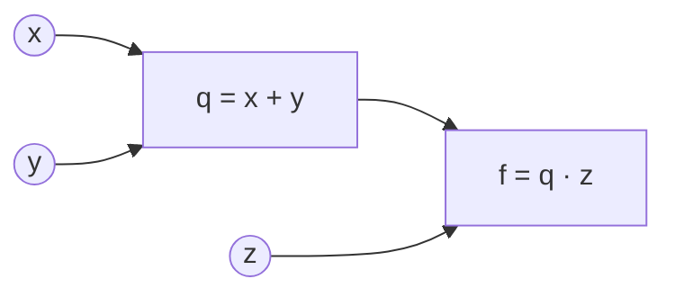

# Jacobians, the chain rule and backprop

**Phase 4 · Lesson 2** · ⏱ ~4 hours · Needs: [Partial derivatives and the gradient](gradient.md), [Matrices are transformations](../linear-algebra/matrices.md)

A neural network is a long composition of functions, each turning a vector into another vector. To train it, we need the derivative of the final loss with respect to every parameter, deep inside the composition. The tool is the multivariable chain rule, and organizing it efficiently is **backpropagation**. By the end of this lesson you'll have derived backprop yourself and computed it by hand.

## 1. The Jacobian: derivative of a vector function

For $\vv f : \R^n \to \R^m$ (with components $f_1, \ldots, f_m$), each output has a gradient. Stack them as rows:

!!! definition "Definition: Jacobian matrix"
    $$
    J_{\vv f}(\vv x) = \begin{pmatrix} \frac{\partial f_1}{\partial x_1} & \cdots & \frac{\partial f_1}{\partial x_n}\\ \vdots & & \vdots\\ \frac{\partial f_m}{\partial x_1} & \cdots & \frac{\partial f_m}{\partial x_n}\end{pmatrix}, \qquad (J)_{ij} = \frac{\partial f_i}{\partial x_j}.
    $$

    Size: $m\times n$ (outputs × inputs). Row $i$ is $\nabla f_i^\top$.

And differentiability means exactly what it meant before: near $\vv x$, $\vv f$ is approximately linear, and the Jacobian is that linear map:

$$
\vv f(\vv x + \vv h) \approx \vv f(\vv x) + J_{\vv f}(\vv x)\,\vv h.
$$

!!! intuition "The Jacobian is the local matrix"
    A smooth nonlinear map, viewed under a microscope at one point, is a linear map. That linear map is the Jacobian. Grids of tiny squares become grids of tiny parallelograms, and $|\det J|$ is the local area-scaling factor (used in [change of variables](integrals.md)).

!!! example "Examples"
    - $\vv f(\vv x) = A\vv x$: $J = A$ everywhere (a linear map is its own linearization).
    - Polar to Cartesian, $(r, \theta) \mapsto (r\cos\theta, r\sin\theta)$: $J = \begin{pmatrix}\cos\theta & -r\sin\theta\\ \sin\theta & r\cos\theta\end{pmatrix}$, with $\det J = r$.
    - Elementwise activation $\vv f(\vv z) = (\sigma(z_1), \ldots, \sigma(z_n))$: $J = \diag(\sigma'(z_1), \ldots, \sigma'(z_n))$. Each output depends only on its own input, so $J$ is diagonal.

## 2. The chain rule: Jacobians multiply

!!! theorem "Multivariable chain rule"
    If $\vv g : \R^n\to\R^m$ is differentiable at $\vv x$ and $\vv f : \R^m \to \R^p$ is differentiable at $\vv g(\vv x)$, then

    $$
    J_{\vv f\circ\vv g}(\vv x) = J_{\vv f}\big(\vv g(\vv x)\big)\;J_{\vv g}(\vv x).
    $$

!!! proof "Proof idea"
    Linearize each map: $\vv g(\vv x + \vv h) \approx \vv g(\vv x) + J_{\vv g}\vv h$, and then $\vv f(\vv g(\vv x) + \vv k) \approx \vv f(\vv g(\vv x)) + J_{\vv f}\vv k$ with $\vv k = J_{\vv g}\vv h$. Composing: $\vv f(\vv g(\vv x + \vv h)) \approx \vv f(\vv g(\vv x)) + J_{\vv f}J_{\vv g}\vv h$. **The linearization of a composition is the composition of the linearizations**, and composing linear maps is multiplying matrices. (Making the error terms rigorous follows the same pattern as the [1D proof](../calculus/derivatives.md#4-the-rules-with-proofs).)

In components this is the familiar "sum over paths" form:

$$
\frac{\partial f_i}{\partial x_j} = \sum_{k=1}^m\frac{\partial f_i}{\partial g_k}\frac{\partial g_k}{\partial x_j}.
$$

**Special case to remember:** if $\vv x(t)$ is a path and $f$ is scalar, then $\frac{d}{dt}f(\vv x(t)) = \nabla f(\vv x(t))\cdot\vv x'(t)$.

## 3. Computational graphs

Any formula can be broken into elementary steps and drawn as a graph. Take $f(x, y, z) = (x + y)\,z$:

**Forward pass** (compute values) at $x = -2, y = 5, z = -4$: $q = 3$, $f = -12$.

**Backward pass** (compute derivatives of $f$ with respect to everything, starting from the end). Each node only needs its *local* derivative and the derivative flowing back into it:

- $\frac{\partial f}{\partial f} = 1$.
- $f = qz$: $\frac{\partial f}{\partial z} = q = 3$ and $\frac{\partial f}{\partial q} = z = -4$.
- $q = x + y$: $\frac{\partial q}{\partial x} = \frac{\partial q}{\partial y} = 1$, so $\frac{\partial f}{\partial x} = \frac{\partial f}{\partial q}\cdot1 = -4$ and $\frac{\partial f}{\partial y} = -4$.

The rule at every node: **downstream gradient = upstream gradient × local derivative.** If a variable feeds into several nodes, add up the gradients flowing back from each (that's the sum in the chain rule).

## 4. Forward mode vs reverse mode

For a chain $\vv x \xrightarrow{g_1} \vv h_1\xrightarrow{g_2}\vv h_2 \to \cdots\xrightarrow{g_L} L$, with scalar loss $L$, the chain rule gives

$$
\nabla_{\vv x}L^\top = \underbrace{J_L}_{1\times d}\;J_{L-1}\;\cdots\;J_2\;J_1.
$$

Matrix multiplication is associative, so we can evaluate this product in any order, but the costs differ enormously:

- **Forward mode** (right to left, $J_2J_1$ first): multiplies big matrix by big matrix at every step. That's efficient when there are few *inputs* and many outputs.
- **Reverse mode** (left to right): start with the $1\times d$ row vector $J_L$ and multiply by each Jacobian in turn. Every intermediate result is a **row vector**, so each step is a cheap vector–matrix product.

!!! intuition "Why backprop is fast"
    With one scalar loss and a billion parameters, reverse mode gets **all billion partial derivatives for roughly the cost of a couple of forward passes**. Forward mode would need a billion passes, one per parameter. That asymmetry is the reason deep learning is computationally feasible. **Backpropagation = reverse-mode differentiation of the loss.**

## 5. Worked example: one neuron, by hand

Input $\vv x = (1, 2)$, weights $\vv w = (0.5, -0.25)$, bias $b = 0.1$, target $y = 1$. Model: $z = \vv w\cdot\vv x + b$, $a = \sigma(z)$, loss $L = \frac12(a - y)^2$.

**Forward:**

| quantity | value |
|---|---|
| $z = 0.5\cdot1 - 0.25\cdot2 + 0.1$ | $0.1$ |
| $a = \sigma(0.1)$ | $0.524979$ |
| $L = \frac12(a - 1)^2$ | $0.112822$ |

**Backward** (each line = previous line × local derivative):

| gradient | formula | value |
|---|---|---|
| $\partial L/\partial a$ | $a - y$ | $-0.475021$ |
| $\partial L/\partial z$ | $\frac{\partial L}{\partial a}\cdot\sigma'(z) = \frac{\partial L}{\partial a}\cdot a(1 - a)$ | $-0.475021 \times 0.249376 = -0.118459$ |
| $\partial L/\partial\vv w$ | $\frac{\partial L}{\partial z}\cdot\vv x$ | $(-0.118459,\ -0.236918)$ |
| $\partial L/\partial b$ | $\frac{\partial L}{\partial z}\cdot 1$ | $-0.118459$ |

A gradient descent step with $\eta = 1$ gives $\vv w \leftarrow (0.618, -0.013)$ and $b \leftarrow 0.218$, increasing $z$ and pushing $a$ toward the target 1. Notice that nothing was computed twice: the backward pass reused $a$ from the forward pass.

## 6. Backprop for a full layer, in matrix form

A two-layer network:

$$
\vv z_1 = W_1\vv x + \vv b_1,\quad \vv h = \phi(\vv z_1),\quad \vv z_2 = W_2\vv h + \vv b_2,\quad L = \ell(\vv z_2, \vv y).
$$

Write $\boldsymbol\delta_2 = \nabla_{\vv z_2}L$ (the "error signal" at the output; for softmax + cross-entropy it's $\vv p - \vv y$, derived in [Matrix calculus](matrix-calculus.md)).

!!! theorem "Backprop equations"
    $$
    \begin{aligned}
    \nabla_{W_2}L &= \boldsymbol\delta_2\,\vv h^\top, & \nabla_{\vv b_2}L &= \boldsymbol\delta_2,\\
    \nabla_{\vv h}L &= W_2^\top\boldsymbol\delta_2, & \boldsymbol\delta_1 = \nabla_{\vv z_1}L &= (W_2^\top\boldsymbol\delta_2)\odot\phi'(\vv z_1),\\
    \nabla_{W_1}L &= \boldsymbol\delta_1\,\vv x^\top, & \nabla_{\vv b_1}L &= \boldsymbol\delta_1.
    \end{aligned}
    $$

    ($\odot$ is elementwise multiplication.)

!!! proof "Derivation"
    *Weight gradient:* $z_{2,i} = \sum_j(W_2)_{ij}h_j + b_{2,i}$, so $\frac{\partial z_{2,i}}{\partial(W_2)_{ij}} = h_j$, and $W_{2,ij}$ affects only $z_{2,i}$. Hence $\frac{\partial L}{\partial(W_2)_{ij}} = \delta_{2,i}h_j$, the $(i,j)$ entry of $\boldsymbol\delta_2\vv h^\top$.

    *Passing back through the linear map:* the Jacobian of $\vv z_2$ with respect to $\vv h$ is $W_2$. By the chain rule, $\nabla_{\vv h}L^\top = \boldsymbol\delta_2^\top W_2$, i.e. $\nabla_{\vv h}L = W_2^\top\boldsymbol\delta_2$. **Going backward through a linear layer multiplies by the transpose.**

    *Passing back through the activation:* its Jacobian is $\diag(\phi'(\vv z_1))$, and multiplying by a diagonal matrix is elementwise multiplication.

    The first-layer formulas are the same pattern again.

Shape check, the best debugging tool: $\boldsymbol\delta_2\vv h^\top$ is (outputs × 1)(1 × hidden) = outputs × hidden, the same shape as $W_2$. ✓ Gradients always have the same shape as the thing they're the gradient of.

!!! ml "Where this shows up"
    - **Every deep learning framework** (PyTorch autograd, JAX `grad`, TensorFlow) builds a computational graph during the forward pass and runs reverse mode over it. `loss.backward()` is exactly §3–§6.
    - **Vanishing/exploding gradients:** $\boldsymbol\delta_1 = (W_2^\top\boldsymbol\delta_2)\odot\phi'(\vv z_1)$. Through $L$ layers that's a product of $L$ matrices and derivative factors. If they're typically smaller than 1 the signal vanishes; larger than 1, it explodes. Residual connections $\vv h_{\text{out}} = \vv h + F(\vv h)$ add an identity to each Jacobian, giving gradients a clean path back.
    - **Memory cost of training:** reverse mode must store the forward activations for use in the backward pass. That's why training uses much more memory than inference, and why "gradient checkpointing" trades recomputation for memory.

## Check yourself

**1.** Compute the Jacobian of $\vv f(x, y) = (x^2y,\ x + \sin y)$.

??? success "Solution"
    $\begin{pmatrix}2xy & x^2\\ 1 & \cos y\end{pmatrix}$.

**2.** If $x = r\cos\theta$, $y = r\sin\theta$ and $f(x,y) = x^2 + y^2$, use the chain rule to compute $\partial f/\partial\theta$ and explain the answer.

??? success "Solution"
    $\frac{\partial f}{\partial\theta} = 2x(-r\sin\theta) + 2y(r\cos\theta) = -2r^2\cos\theta\sin\theta + 2r^2\sin\theta\cos\theta = 0$. Makes sense: $f = r^2$ doesn't depend on the angle.

**3.** Backprop through $f = (xy + z)^2$ at $x = 1, y = 2, z = -1$. Find all three partials.

??? success "Solution"
    Forward: $p = xy = 2$, $s = p + z = 1$, $f = s^2 = 1$. Backward: $\partial f/\partial s = 2s = 2$; $\partial f/\partial z = 2$, $\partial f/\partial p = 2$; $\partial f/\partial x = 2y = 4$, $\partial f/\partial y = 2x = 2$.

**4.** In the worked neuron example, what would $\partial L/\partial\vv w$ be if the target were $y = 0$ instead?

??? success "Solution"
    $\partial L/\partial a = a - 0 = 0.524979$; $\partial L/\partial z = 0.524979 \times 0.249376 = 0.130917$; $\partial L/\partial\vv w = (0.130917, 0.261835)$. The sign flips: now the update decreases $z$.

**5.** A layer computes $\vv z = W\vv x$ with $W$ being $3\times5$. Given $\nabla_{\vv z}L$ (length 3), write $\nabla_W L$ and $\nabla_{\vv x}L$ and check their shapes.

??? success "Solution"
    $\nabla_WL = (\nabla_{\vv z}L)\vv x^\top$: $(3\times1)(1\times5) = 3\times5$. ✓ $\nabla_{\vv x}L = W^\top\nabla_{\vv z}L$: $(5\times3)(3\times1) = 5\times1$. ✓

**6.** A function has 1 input and 1000 outputs. Which mode of automatic differentiation is cheaper for its full Jacobian, and why?

??? success "Solution"
    Forward mode: one forward-mode pass, seeded with the single input direction, yields the whole $1000\times1$ Jacobian column. Reverse mode would need 1000 backward passes, one per output.
