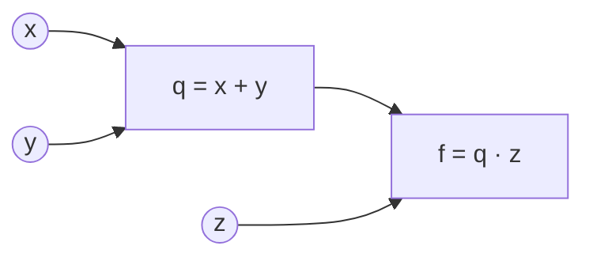

# Jacobians, the chain rule and backprop

**Phase 4 · Lesson 2** · ⏱ ~4 hours · Needs: [Partial derivatives and the gradient](gradient.md), [Matrices are transformations](../linear-algebra/matrices.md)

A neural network is a long composition of functions, each turning a vector into another vector.

To train it, we need the derivative of the final loss with respect to every parameter, deep inside the composition.

- The tool is the multivariable chain rule.
- Organizing it efficiently is **backpropagation**.

By the end of this lesson you'll have derived backprop yourself and computed it by hand.

## 1. The Jacobian: derivative of a vector function

For $\vv f : \R^n \to \R^m$ (with components $f_1, \ldots, f_m$), each output has a gradient. Stack them as rows:

!!! definition "Definition: Jacobian matrix"
    $$
    J_{\vv f}(\vv x) = \begin{pmatrix} \frac{\partial f_1}{\partial x_1} & \cdots & \frac{\partial f_1}{\partial x_n}\\ \vdots & & \vdots\\ \frac{\partial f_m}{\partial x_1} & \cdots & \frac{\partial f_m}{\partial x_n}\end{pmatrix}, \qquad (J)_{ij} = \frac{\partial f_i}{\partial x_j}.
    $$

    Size: $m\times n$ (outputs × inputs). Row $i$ is $\nabla f_i^\top$.

Memory aid: **rows go with outputs, columns with inputs.** Column $j$ says how *all* the outputs respond when you nudge input $j$.

!!! example "Example: a Jacobian, entry by entry"
    $\vv f(x, y) = (x + y,\ xy)$, a map from $\R^2$ to $\R^2$. So $f_1 = x + y$ and $f_2 = xy$.

    | | $\partial/\partial x$ | $\partial/\partial y$ |
    |---|---|---|
    | $f_1 = x + y$ | $1$ | $1$ |
    | $f_2 = xy$ | $y$ | $x$ |

    $$
    J_{\vv f}(x, y) = \begin{pmatrix}1 & 1\\y & x\end{pmatrix}, \qquad J_{\vv f}(2, 3) = \begin{pmatrix}1 & 1\\3 & 2\end{pmatrix}.
    $$

Differentiability means exactly what it meant before: near $\vv x$, $\vv f$ is approximately linear, and the Jacobian is that linear map:

$$
\vv f(\vv x + \vv h) \approx \vv f(\vv x) + J_{\vv f}(\vv x)\,\vv h.
$$

Check with the example at $(2, 3)$ and a small step $\vv h = (0.1, 0)$:

- Exact: $\vv f(2.1, 3) = (5.1, 6.3)$.
- Approximation: $\vv f(2, 3) + J\vv h = (5, 6) + (0.1, 0.3) = (5.1, 6.3)$. ✓ (Exact here, because each component is linear in $x$ alone. Try $\vv h = (0.1, 0.1)$: the approximation gives $(5.2, 6.5)$, the truth $(5.2, 6.51)$.)

!!! intuition "The Jacobian is the local matrix"
    A smooth nonlinear map, viewed under a microscope at one point, is a linear map. That linear map is the Jacobian.

    - Grids of tiny squares become grids of tiny parallelograms.
    - $|\det J|$ is the local area-scaling factor (used in [change of variables](integrals.md)).

!!! example "Examples"
    - $\vv f(\vv x) = A\vv x$: $J = A$ everywhere (a linear map is its own linearization).
    - Polar to Cartesian, $(r, \theta) \mapsto (r\cos\theta, r\sin\theta)$: $J = \begin{pmatrix}\cos\theta & -r\sin\theta\\ \sin\theta & r\cos\theta\end{pmatrix}$, with $\det J = r$.
        - Row 1 differentiates $x = r\cos\theta$: by $r$ gives $\cos\theta$, by $\theta$ gives $-r\sin\theta$. Row 2 does the same for $y = r\sin\theta$.
        - $\det J = r\cos^2\theta + r\sin^2\theta = r$.
    - Elementwise activation $\vv f(\vv z) = (\sigma(z_1), \ldots, \sigma(z_n))$: $J = \diag(\sigma'(z_1), \ldots, \sigma'(z_n))$.
        - Each output depends only on its own input, so $J$ is diagonal.

## 2. The chain rule: Jacobians multiply

!!! theorem "Multivariable chain rule"
    If $\vv g : \R^n\to\R^m$ is differentiable at $\vv x$ and $\vv f : \R^m \to \R^p$ is differentiable at $\vv g(\vv x)$, then

    $$
    J_{\vv f\circ\vv g}(\vv x) = J_{\vv f}\big(\vv g(\vv x)\big)\;J_{\vv g}(\vv x).
    $$

!!! proof "Proof idea"
    Linearize each map:

    1. $\vv g(\vv x + \vv h) \approx \vv g(\vv x) + J_{\vv g}\vv h$.
    2. $\vv f(\vv g(\vv x) + \vv k) \approx \vv f(\vv g(\vv x)) + J_{\vv f}\vv k$, with $\vv k = J_{\vv g}\vv h$.
    3. Composing: $\vv f(\vv g(\vv x + \vv h)) \approx \vv f(\vv g(\vv x)) + J_{\vv f}J_{\vv g}\vv h$.

    **The linearization of a composition is the composition of the linearizations**, and composing linear maps is multiplying matrices.

    (Making the error terms rigorous follows the same pattern as the [1D proof](../calculus/derivatives.md#4-the-rules-with-proofs).)

Notice the shapes line up just like the matrix sizes in a product: $(p \times m)(m \times n) = p \times n$. And with $n = m = p = 1$, it's the ordinary chain rule $(f\circ g)' = f'(g(x))\,g'(x)$.

!!! example "Example: chain rule two ways"
    Let $\vv g(x, y) = (u, v) = (xy,\ x + y)$ and $f(u, v) = u^2 + v$. Find $\nabla(f \circ \vv g)$ at $(x, y) = (1, 2)$.

    **Way 1: substitute first.** $f(\vv g(x, y)) = x^2y^2 + x + y$. Partial derivatives: $(2xy^2 + 1,\ 2x^2y + 1)$. At $(1, 2)$: $(9, 5)$.

    **Way 2: multiply Jacobians.** At $(1, 2)$, $(u, v) = (2, 3)$.

    - $J_f = \begin{pmatrix}2u & 1\end{pmatrix} = \begin{pmatrix}4 & 1\end{pmatrix}$ (a $1 \times 2$ row, since $f$ has one output).
    - $J_{\vv g} = \begin{pmatrix}y & x\\1 & 1\end{pmatrix} = \begin{pmatrix}2 & 1\\1 & 1\end{pmatrix}$.
    - Product: $\begin{pmatrix}4 & 1\end{pmatrix}\begin{pmatrix}2 & 1\\1 & 1\end{pmatrix} = \begin{pmatrix}8 + 1 & 4 + 1\end{pmatrix} = \begin{pmatrix}9 & 5\end{pmatrix}$. ✓

    For small examples, substituting is easier. For a neural network with millions of intermediate values, you can't write out the substituted formula, and Way 2 is the only option.

In components this is the familiar "sum over paths" form:

$$
\frac{\partial f_i}{\partial x_j} = \sum_{k=1}^m\frac{\partial f_i}{\partial g_k}\frac{\partial g_k}{\partial x_j}.
$$

!!! intuition "Sum over paths"
    Changing $x_j$ affects $f_i$ through every intermediate variable $g_k$ that depends on $x_j$. Each route contributes (rate along the first leg) × (rate along the second leg), and the effects of the routes add up.

    In the example, $x$ reaches $f$ by two routes:

    - through $u = xy$: $\ \frac{\partial f}{\partial u}\frac{\partial u}{\partial x} = 4 \cdot 2 = 8$;
    - through $v = x + y$: $\ \frac{\partial f}{\partial v}\frac{\partial v}{\partial x} = 1 \cdot 1 = 1$.

    Total: $8 + 1 = 9$. Same answer, read as a sum instead of a matrix product.

**Special case to remember:** if $\vv x(t)$ is a path and $f$ is scalar, then $\frac{d}{dt}f(\vv x(t)) = \nabla f(\vv x(t))\cdot\vv x'(t)$.

For example, walk around the unit circle, $\vv x(t) = (\cos t, \sin t)$, on the landscape $f(x, y) = x^2 y$. Then $\nabla f = (2xy, x^2)$ and $\vv x'(t) = (-\sin t, \cos t)$, so

$$
\frac{d}{dt}f = 2\cos t\sin t\cdot(-\sin t) + \cos^2 t\cdot\cos t = \cos^3 t - 2\cos t\sin^2 t.
$$

(You can confirm by differentiating $f(\vv x(t)) = \cos^2 t\sin t$ directly with the product rule.)

## 3. Computational graphs

Any formula can be broken into elementary steps and drawn as a graph. Take $f(x, y, z) = (x + y)\,z$:

**Forward pass** (compute values) at $x = -2, y = 5, z = -4$:

- $q = 3$
- $f = -12$

**Backward pass** (compute derivatives of $f$ with respect to everything, starting from the end). Each node only needs its *local* derivative and the derivative flowing back into it:

- $\frac{\partial f}{\partial f} = 1$.
- $f = qz$: $\frac{\partial f}{\partial z} = q = 3$ and $\frac{\partial f}{\partial q} = z = -4$.
- $q = x + y$: $\frac{\partial q}{\partial x} = \frac{\partial q}{\partial y} = 1$, so $\frac{\partial f}{\partial x} = \frac{\partial f}{\partial q}\cdot1 = -4$ and $\frac{\partial f}{\partial y} = -4$.

The rule at every node:

> **downstream gradient = upstream gradient × local derivative.**

If a variable feeds into several nodes, add up the gradients flowing back from each. (That's the sum in the chain rule.)

!!! example "Example: a variable used twice"
    $f = x \cdot y + x$ at $x = 3$, $y = 4$. Break it up: $p = xy$, then $f = p + x$. Here $x$ feeds two nodes.

    - Forward: $p = 12$, $f = 15$.
    - Backward: $\frac{\partial f}{\partial p} = 1$. Then:
        - via $p$: $\ \frac{\partial f}{\partial p}\cdot\frac{\partial p}{\partial x} = 1 \cdot y = 4$;
        - directly: $\ \frac{\partial f}{\partial x}\big\rvert_{\text{direct}} = 1$.
    - Total: $\frac{\partial f}{\partial x} = 4 + 1 = 5$.

    Check by ordinary calculus: $\frac{\partial}{\partial x}(xy + x) = y + 1 = 5$. ✓ Forgetting to add the two contributions is the most common hand-backprop mistake.

## 4. Forward mode vs reverse mode

For a chain $\vv x \xrightarrow{g_1} \vv h_1\xrightarrow{g_2}\vv h_2 \to \cdots\xrightarrow{g_L} L$, with scalar loss $L$, the chain rule gives

$$
\nabla_{\vv x}L^\top = \underbrace{J_L}_{1\times d}\;J_{L-1}\;\cdots\;J_2\;J_1.
$$

(The transpose is there because $\nabla_{\vv x} L$ is a column vector, while the Jacobian of a scalar function is a row: $J_L = \nabla L^\top$.)

Matrix multiplication is associative, so we can evaluate this product in any order. But the costs differ enormously.

A concrete count: suppose every layer has width $d = 1000$, so each $J_k$ is $1000 \times 1000$, except the last, $J_L$, which is $1 \times 1000$.

- **Right to left:** $J_2J_1$ is a matrix–matrix product, about $d^3 = 10^9$ operations, and every later step is another one.
- **Left to right:** $J_L J_{L-1}$ is a row times a matrix, about $d^2 = 10^6$ operations, and the result is again a row. Every step stays this cheap.

That's a factor of $d = 1000$ per layer.

| Mode | Order | Each step | Efficient when |
|---|---|---|---|
| **Forward** | right to left ($J_2J_1$ first) | big matrix × big matrix | few *inputs*, many outputs |
| **Reverse** | left to right (start from the $1\times d$ row $J_L$) | row vector × matrix (cheap) | many inputs, few outputs (one loss) |

!!! intuition "Why backprop is fast"
    With one scalar loss and a billion parameters:

    - reverse mode gets **all billion partial derivatives for roughly the cost of a couple of forward passes**;
    - forward mode would need a billion passes, one per parameter.

    That asymmetry is the reason deep learning is computationally feasible.

    **Backpropagation = reverse-mode differentiation of the loss.**

## 5. Worked example: one neuron, by hand

**Setup:**

| | |
|---|---|
| input | $\vv x = (1, 2)$ |
| weights | $\vv w = (0.5, -0.25)$ |
| bias | $b = 0.1$ |
| target | $y = 1$ |
| model | $z = \vv w\cdot\vv x + b$, $\ a = \sigma(z)$ |
| loss | $L = \frac12(a - y)^2$ |

**Forward:**

| quantity | value |
|---|---|
| $z = 0.5\cdot1 - 0.25\cdot2 + 0.1$ | $0.1$ |
| $a = \sigma(0.1)$ | $0.524979$ |
| $L = \frac12(a - 1)^2$ | $0.112822$ |

**Backward.** The chain of dependence is $\vv w \to z \to a \to L$, so the chain rule says

$$
\frac{\partial L}{\partial w_j} = \frac{\partial L}{\partial a}\cdot\frac{\partial a}{\partial z}\cdot\frac{\partial z}{\partial w_j}.
$$

The three local derivatives:

- $L = \frac12(a - y)^2$, so $\frac{\partial L}{\partial a} = a - y$ (the $\frac12$ cancels the 2 from the power rule; that's why it's there).
- $a = \sigma(z)$, so $\frac{\partial a}{\partial z} = \sigma'(z) = a(1 - a)$ (from [Derivatives](../calculus/derivatives.md#6-worked-examples-from-ml)).
- $z = w_1x_1 + w_2x_2 + b$, so $\frac{\partial z}{\partial w_j} = x_j$ and $\frac{\partial z}{\partial b} = 1$.

Compute from the loss backward, each line = previous line × local derivative:

| gradient | formula | value |
|---|---|---|
| $\partial L/\partial a$ | $a - y$ | $-0.475021$ |
| $\partial L/\partial z$ | $\frac{\partial L}{\partial a}\cdot\sigma'(z) = \frac{\partial L}{\partial a}\cdot a(1 - a)$ | $-0.475021 \times 0.249376 = -0.118459$ |
| $\partial L/\partial\vv w$ | $\frac{\partial L}{\partial z}\cdot\vv x$ | $(-0.118459,\ -0.236918)$ |
| $\partial L/\partial b$ | $\frac{\partial L}{\partial z}\cdot 1$ | $-0.118459$ |

A gradient descent step with $\eta = 1$ gives:

- $\vv w \leftarrow (0.618, -0.013)$
- $b \leftarrow 0.218$

This increases $z$ and pushes $a$ toward the target 1.

Notice that nothing was computed twice: the backward pass reused $a$ from the forward pass.

## 6. Backprop for a full layer, in matrix form

A two-layer network:

$$
\vv z_1 = W_1\vv x + \vv b_1,\quad \vv h = \phi(\vv z_1),\quad \vv z_2 = W_2\vv h + \vv b_2,\quad L = \ell(\vv z_2, \vv y).
$$

Write $\boldsymbol\delta_2 = \nabla_{\vv z_2}L$, the "error signal" at the output. (For softmax + cross-entropy it's $\vv p - \vv y$, derived in [Matrix calculus](matrix-calculus.md).)

!!! theorem "Backprop equations"
    $$
    \begin{aligned}
    \nabla_{W_2}L &= \boldsymbol\delta_2\,\vv h^\top, & \nabla_{\vv b_2}L &= \boldsymbol\delta_2,\\
    \nabla_{\vv h}L &= W_2^\top\boldsymbol\delta_2, & \boldsymbol\delta_1 = \nabla_{\vv z_1}L &= (W_2^\top\boldsymbol\delta_2)\odot\phi'(\vv z_1),\\
    \nabla_{W_1}L &= \boldsymbol\delta_1\,\vv x^\top, & \nabla_{\vv b_1}L &= \boldsymbol\delta_1.
    \end{aligned}
    $$

    ($\odot$ is elementwise multiplication.)

!!! proof "Derivation"
    **Weight gradient.**

    - $z_{2,i} = \sum_j(W_2)_{ij}h_j + b_{2,i}$, so $\frac{\partial z_{2,i}}{\partial(W_2)_{ij}} = h_j$.
    - $W_{2,ij}$ affects only $z_{2,i}$.
    - Hence $\frac{\partial L}{\partial(W_2)_{ij}} = \delta_{2,i}h_j$, the $(i,j)$ entry of $\boldsymbol\delta_2\vv h^\top$.

    **Passing back through the linear map.** The Jacobian of $\vv z_2$ with respect to $\vv h$ is $W_2$. By the chain rule, $\nabla_{\vv h}L^\top = \boldsymbol\delta_2^\top W_2$, i.e. $\nabla_{\vv h}L = W_2^\top\boldsymbol\delta_2$.

    In components, using "sum over paths": $h_j$ affects *every* output $z_{2,i}$, with $\frac{\partial z_{2,i}}{\partial h_j} = (W_2)_{ij}$. So

    $$
    \frac{\partial L}{\partial h_j} = \sum_i \frac{\partial L}{\partial z_{2,i}}\frac{\partial z_{2,i}}{\partial h_j} = \sum_i \delta_{2,i}(W_2)_{ij} = \big(W_2^\top\boldsymbol\delta_2\big)_j.
    $$

    The sum runs down column $j$ of $W_2$, which is row $j$ of $W_2^\top$.

    **Going backward through a linear layer multiplies by the transpose.**

    **Passing back through the activation.** Its Jacobian is $\diag(\phi'(\vv z_1))$, and multiplying by a diagonal matrix is elementwise multiplication.

    The first-layer formulas are the same pattern again.

**Shape check**, the best debugging tool: $\boldsymbol\delta_2\vv h^\top$ is (outputs × 1)(1 × hidden) = outputs × hidden, the same shape as $W_2$. ✓

Gradients always have the same shape as the thing they're the gradient of.

!!! ml "Where this shows up"
    - **Every deep learning framework** (PyTorch autograd, JAX `grad`, TensorFlow) builds a computational graph during the forward pass and runs reverse mode over it.
        - `loss.backward()` is exactly §3–§6.
    - **Vanishing/exploding gradients:** $\boldsymbol\delta_1 = (W_2^\top\boldsymbol\delta_2)\odot\phi'(\vv z_1)$. Through $L$ layers that's a product of $L$ matrices and derivative factors.
        - Typically smaller than 1: the signal vanishes. Larger than 1: it explodes.
        - Residual connections $\vv h_{\text{out}} = \vv h + F(\vv h)$ add an identity to each Jacobian, giving gradients a clean path back.
    - **Memory cost of training:** reverse mode must store the forward activations for use in the backward pass.
        - That's why training uses much more memory than inference.
        - "Gradient checkpointing" trades recomputation for memory.

## Check yourself

**1.** Compute the Jacobian of $\vv f(x, y) = (x^2y,\ x + \sin y)$.

??? success "Solution"
    $\begin{pmatrix}2xy & x^2\\ 1 & \cos y\end{pmatrix}$.

**2.** If $x = r\cos\theta$, $y = r\sin\theta$ and $f(x,y) = x^2 + y^2$, use the chain rule to compute $\partial f/\partial\theta$ and explain the answer.

??? success "Solution"
    $$
    \frac{\partial f}{\partial\theta} = 2x(-r\sin\theta) + 2y(r\cos\theta) = -2r^2\cos\theta\sin\theta + 2r^2\sin\theta\cos\theta = 0.
    $$

    Makes sense: $f = r^2$ doesn't depend on the angle.

**3.** Backprop through $f = (xy + z)^2$ at $x = 1, y = 2, z = -1$. Find all three partials.

??? success "Solution"
    **Forward:** $p = xy = 2$, $\ s = p + z = 1$, $\ f = s^2 = 1$.

    **Backward:**

    | Gradient | Value |
    |---|---|
    | $\partial f/\partial s = 2s$ | $2$ |
    | $\partial f/\partial z = \partial f/\partial s$ | $2$ |
    | $\partial f/\partial p = \partial f/\partial s$ | $2$ |
    | $\partial f/\partial x = 2\cdot y$ | $4$ |
    | $\partial f/\partial y = 2\cdot x$ | $2$ |

**4.** In the worked neuron example, what would $\partial L/\partial\vv w$ be if the target were $y = 0$ instead?

??? success "Solution"
    - $\partial L/\partial a = a - 0 = 0.524979$
    - $\partial L/\partial z = 0.524979 \times 0.249376 = 0.130917$
    - $\partial L/\partial\vv w = (0.130917, 0.261835)$

    The sign flips: now the update decreases $z$.

**5.** A layer computes $\vv z = W\vv x$ with $W$ being $3\times5$. Given $\nabla_{\vv z}L$ (length 3), write $\nabla_W L$ and $\nabla_{\vv x}L$ and check their shapes.

??? success "Solution"
    - $\nabla_WL = (\nabla_{\vv z}L)\vv x^\top$: $(3\times1)(1\times5) = 3\times5$. ✓
    - $\nabla_{\vv x}L = W^\top\nabla_{\vv z}L$: $(5\times3)(3\times1) = 5\times1$. ✓

**6.** A function has 1 input and 1000 outputs. Which mode of automatic differentiation is cheaper for its full Jacobian, and why?

??? success "Solution"
    **Forward mode.**

    - One forward-mode pass, seeded with the single input direction, yields the whole $1000\times1$ Jacobian column.
    - Reverse mode would need 1000 backward passes, one per output.
