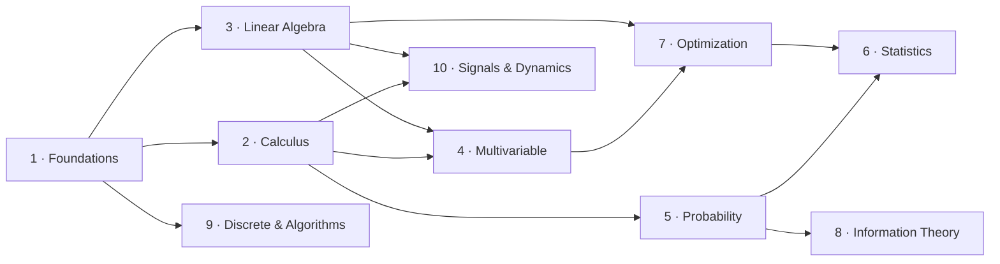

# The roadmap

Your progress

## How the phases depend on each other

An arrow means "is used by". You can work on any phase whose arrows all come from phases you've finished.

!!! tip "Interleaving is allowed"
    Phases 2 and 3 are independent, and so are 5 and 9. Many people find it refreshing to alternate, e.g. a calculus lesson then a linear algebra lesson, instead of doing one phase in a block.

## Tracks

You don't have to do everything in order. Pick the track that matches your goal. Each one is the full set of prerequisites for that goal.

=== "Machine learning / deep learning"

    Phases **1 → 2 → 3 → 4 → 5 → 6 → 7 → 8**.

    You may skip:

    - complex numbers (until Phase 10);
    - *Solving linear systems* §LU;
    - *Multiple integrals* (on a first pass);
    - *Confidence intervals and tests*;
    - *Constraints, KKT and duality* (until you meet SVMs).

=== "Algorithms / CS theory"

    Phases **1 → 9**, then **5** (probability for randomized algorithms) and **3** (for graph algorithms on matrices, spectral methods).

=== "Information theory"

    Phases **1 → 2 (Integrals, Series) → 5 → 8**, plus *Convexity and Jensen* from Phase 7.

=== "Physics foundations"

    Phases **1 → 2 → 3 → 4 → 10**, with Phase 5 for statistical mechanics and quantum measurement.

## All lessons

Each lesson shows ✓ here once you've marked it complete.

**Phase 1 · Foundations**

1. [Logic and proofs](../foundations/logic-and-proofs.md)
2. [Sets, functions and notation](../foundations/sets-functions.md)
3. [Exponentials, logarithms and trig](../foundations/exp-log-trig.md)
4. [Complex numbers](../foundations/complex-numbers.md)

**Phase 2 · Calculus**

1. [Limits and continuity](../calculus/limits.md)
2. [Derivatives](../calculus/derivatives.md)
3. [Using derivatives](../calculus/applications.md)
4. [Integrals](../calculus/integrals.md)
5. [Series and Taylor expansions](../calculus/series-taylor.md)

**Phase 3 · Linear Algebra**

1. [Vectors and the dot product](../linear-algebra/vectors.md)
2. [Matrices are transformations](../linear-algebra/matrices.md)
3. [Solving linear systems](../linear-algebra/linear-systems.md)
4. [Vector spaces, basis, rank](../linear-algebra/vector-spaces.md)
5. [Determinants](../linear-algebra/determinants.md)
6. [Orthogonality and least squares](../linear-algebra/orthogonality.md)
7. [Eigenvalues and eigenvectors](../linear-algebra/eigen.md)
8. [Symmetric matrices and the spectral theorem](../linear-algebra/spectral.md)
9. [SVD and PCA](../linear-algebra/svd.md)

**Phase 4 · Multivariable Calculus**

1. [Partial derivatives and the gradient](../multivariable/gradient.md)
2. [Jacobians, the chain rule and backprop](../multivariable/chain-rule.md)
3. [The Hessian and second-order Taylor](../multivariable/hessian.md)
4. [Matrix calculus for ML](../multivariable/matrix-calculus.md)
5. [Multiple integrals and change of variables](../multivariable/integrals.md)
6. [Lagrange multipliers](../multivariable/lagrange.md)

**Phase 5 · Probability**

1. [Counting](../probability/counting.md)
2. [Probability, conditioning and Bayes](../probability/foundations.md)
3. [Random variables and expectation](../probability/random-variables.md)
4. [The distribution zoo](../probability/distributions.md)
5. [Several random variables](../probability/joint.md)
6. [Inequalities and limit theorems](../probability/limit-theorems.md)

**Phase 6 · Statistics**

1. [Estimation, MLE and MAP](../statistics/estimation.md)
2. [Bias, variance and generalization](../statistics/bias-variance.md)
3. [Confidence intervals and tests](../statistics/inference.md)

**Phase 7 · Optimization**

1. [Convexity and Jensen](../optimization/convexity.md)
2. [Gradient descent and friends](../optimization/gradient-descent.md)
3. [Constraints, KKT and duality](../optimization/constrained.md)

**Phase 8 · Information Theory**

1. [Entropy](../information-theory/entropy.md)
2. [Cross-entropy, KL and mutual information](../information-theory/kl-divergence.md)
3. [Compression and coding](../information-theory/coding.md)

**Phase 9 · Discrete Math & Algorithms**

1. [Asymptotics and Big-O](../discrete/asymptotics.md)
2. [Recurrences and divide and conquer](../discrete/recurrences.md)
3. [Graphs](../discrete/graphs.md)
4. [Number theory for computing](../discrete/number-theory.md)

**Phase 10 · Signals & Dynamics**

1. [Differential equations](../further/differential-equations.md)
2. [Fourier series and transforms](../further/fourier.md)

## Milestones worth celebrating

- 🎯 **After Phase 3**: you understand what every line of `numpy.linalg` does.
- 🎯 **After Phase 4**: you can derive backpropagation by hand.
- 🎯 **After Phase 6**: you know why "minimize mean squared error" and "maximize likelihood" are the same thing.
- 🎯 **After Phase 8**: you know exactly what the cross-entropy loss of a language model measures.
